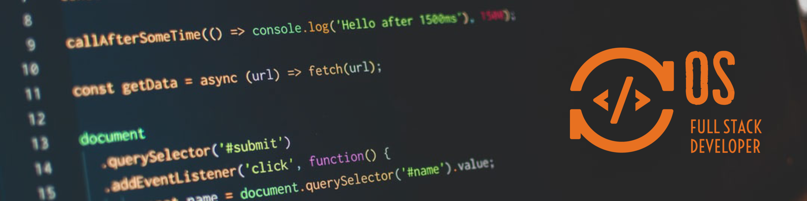

 

## 👨‍💻 About Me

I'm a full-stack developer who enjoys building clean, reliable web applications with **C#** and **.NET**, and turning messy legacy code into something modern. I like solving real problems, learning new tools, and helping others grow as developers.

- 🔭 Building web apps with **C#**, **.NET** and **Blazor**
- 🌱 Always exploring new tech, lately **AI-assisted development**
- 🤝 Enjoy clean architecture, code reviews and mentoring
- 📫 Find me on [LinkedIn](https://www.linkedin.com/in/oleksandrshchegol/) or at [oshchegol-dev.com](https://www.oshchegol-dev.com/)

## 🛠️ Tech Stack

  

 

<b>Clean Architecture</b> · <b>REST APIs</b> · <b>JWT Auth</b> · <b>Code Review</b> · <b>Mentoring</b>

## 🐍 Contribution Activity

  <picture>
    <source media="(prefers-color-scheme: dark)" srcset="https://raw.githubusercontent.com/OAleksandr/OAleksandr/output/github-snake-dark.svg" />
    <source media="(prefers-color-scheme: light)" srcset="https://raw.githubusercontent.com/OAleksandr/OAleksandr/output/github-snake.svg" />
    
  </picture>

